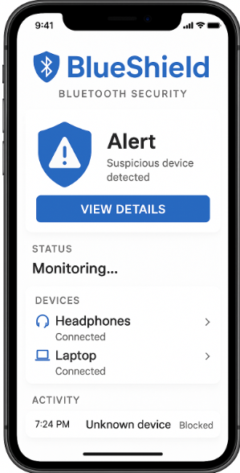

# BlueShield

Bluetooth security monitoring for Raspberry Pi. BlueShield scans BLE and Classic
Bluetooth, fingerprints devices across MAC rotation, flags trackers and
following behaviour, and presents everything in a real-time web dashboard. A
research-grade BLE jammer is included for authorised testing.



> **Scope.** BlueShield is a security research and defensive monitoring tool.
> Only operate the sniffer and jammer against devices and RF environments you
> own or are explicitly authorised to test. Transmitting on Bluetooth bands to
> disrupt third-party devices is illegal in most jurisdictions.

## Features

**Monitoring**
- BLE and Classic Bluetooth scanning with GATT service resolution
- Fingerprint engine that clusters rotating MAC addresses into stable identities
- Device classification (phone, laptop, wearable, audio, tracker) with OUI enrichment
- Tracker detection for AirTag, Samsung SmartTag, and Tile
- Following and shadow-device analysis; environment safety scoring

**Dashboard**
- Live device list, radar, signal timeline, and BLE heatmap
- Mobile-responsive layout with bottom navigation
- Role-based access (operator / read-only demo) and session authentication
- JSON audit logging for incident review

**Testing (authorised use only)**
- BLE jammer with sweep, reactive, targeted, and continuous modes
- nRF52840 sniffer support (ButteRFly and Sniffle firmware)

## Requirements

- Raspberry Pi 3B+, 4, or 5 running Debian 12 (Bookworm)
- Python 3.10 or newer
- For sniffer/jammer roles, an external BLE adapter (see [Hardware](#hardware))

## Installation

### One-line install

```bash
curl -fsSL https://raw.githubusercontent.com/mathib2/BlueShield-Public-/master/scripts/install.sh | sudo bash
```

The installer verifies the Pi model, Debian version, and Python; installs system
dependencies (BlueZ, build tools, libcap, cloudflared); clones the repo into
`/opt/blueshield`; creates a virtualenv and installs `requirements.txt`; installs
the udev rules for nRF52 dongles; grants raw-HCI capabilities to the venv Python;
and installs and starts the systemd service. It finishes in roughly two minutes
and prints the LAN URL and login.

### From a clone

```bash
git clone https://github.com/mathib2/BlueShield-Public-.git
cd BlueShield-Public-
sudo bash scripts/install.sh
```

### From the private repository

The private repo (`pineconegoat/BlueShield`) tracks the same code as the public
mirror. Install from the mirror unless you need an unreleased branch. When you
do, choose the auth path that fits your setup — see
[docs/INSTALL_PRIVATE.md](docs/INSTALL_PRIVATE.md) for personal-access-token,
SSH deploy-key, and local-checkout instructions.

## First run

Default credentials are `admin` / `admin123`. **Change them** under
Config → Operators before exposing the dashboard to an untrusted network. The
login page also surfaces a Cloudflare quick-tunnel URL for off-LAN access.

### Service control

```bash
sudo systemctl status blueshield      # service state
sudo journalctl -u blueshield -f      # follow logs
sudo systemctl restart blueshield     # apply code changes
sudo bash /opt/blueshield/scripts/uninstall.sh   # clean removal
```

## Hardware

The Pi's onboard radio drives the basic BLE scanner. The sniffer and jammer
expect an external adapter:

| Hardware | Role | Notes |
|---|---|---|
| Realtek BT 5.x USB dongle | Scanner / jammer | Low cost, 4–5 dBm tx |
| nRF52840 dongle (ButteRFly firmware) | Sniffer + injection | [Flashing guide](https://github.com/whad-team/butterfly) |
| nRF52840 dongle (Sniffle firmware) | Sniffer | [Flashing guide](https://github.com/nccgroup/Sniffle) |

The installer's udev rules cover the ButteRFly (`c0ff:eeee`) and Sniffle
(`1915:520f`) USB IDs. List adapters with `hciconfig -a`. If your scanner
enumerates as `hci1` rather than the default `hci2`, set it from the dashboard:

```bash
curl -X POST -d '{"interface":"hci1"}' -H 'Content-Type: application/json' \
    http://localhost:8080/api/config
```

## Platform support

| Platform  | BLE scanning     | Classic BT       | Jammer                | Dashboard |
|-----------|------------------|------------------|-----------------------|-----------|
| Linux/RPi | Bleak + hcitool  | hcitool/hcidump  | Real HCI (raw socket) | Full      |
| Windows   | Bleak            | Not supported    | Simulated             | Full      |

## Project structure

```
blueshield/
  scanner/       BLE + Classic scanning, fingerprinting, classification, analysis
  jammer/        BLE jammer (raw HCI with hcitool fallback)
  sniffer/       nRF52840 capture (ButteRFly / Sniffle)
  dashboard/     Flask + Socket.IO server and web frontend
  logs/          JSON event logging and analytics
  config/        Configuration management
```

## Documentation

- [DESIGN.md](DESIGN.md) — dashboard design system and UI tokens
- [docs/](docs/) — jamming research notes and demo playbook
- `BlueShield_Guide.pdf` — product and technical guide

## Team

Mathias Vera · Daniel Halbleib Jr · Andrew Sauls

## License

See [LICENSE](LICENSE). Research and defensive use only; contact the team for
commercial licensing.
